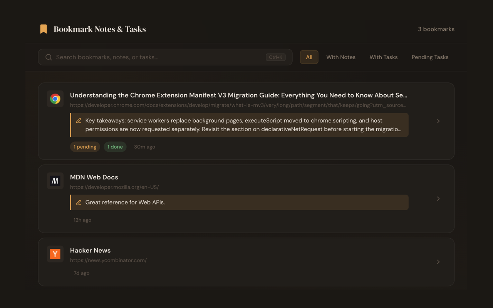

# Bookmark Notes & Tasks

A Chrome extension that turns a plain bookmark into a small workspace: save the
page you are on, then attach the context you will actually need later - a note to
yourself and a checklist of things to do.

Everything is stored locally in your browser. No account, no sync server, no
tracking, and no network requests - the extension works fully offline.



## Features

- **One-click bookmarking** of the current tab from the toolbar popup, capturing
  its title, URL, and favicon automatically.
- **Notes** on any bookmark - a summary, a quote, a reminder.
- **Task checklists** on any bookmark, with pending/done tracking.
- **Full-page dashboard** listing every bookmark, note, and task together.
- **Open in a new tab** from any dashboard card or bookmark detail view (the
  open button, or click the URL).
- **Export JSON**: download every bookmark with its notes, tasks, and
  timestamps as one `bookmark-notes-YYYY-MM-DD.json` file, generated locally.
- **Instant search** across bookmarks, notes, and tasks (`Ctrl+K`).
- **Filters**: All, With Notes, With Tasks, Pending Tasks.
- **Remove** a bookmark - and its notes and tasks - when you are finished.

## Install

The extension will be available on the Chrome Web Store (listing pending review).

### Load unpacked (for development)

1. Clone this repository.
2. Open `chrome://extensions` and enable **Developer mode**.
3. Click **Load unpacked** and select the repository folder.

## Build the Web Store package

From the repository root:

```sh
zip -r bookmark-notes-tasks-v1.0.0.zip \
  manifest.json \
  popup.html popup.css popup.js \
  all-bookmarks.html all-bookmarks.css all-bookmarks.js \
  icons \
  fonts \
  -x '*.DS_Store'
```

Bump the `version` in `manifest.json` for every new upload of an already-published
item. Store listing copy, screenshots, and a submission guide live in
[`store-assets/`](store-assets/).

## Permissions

The manifest requests only what the code uses:

| Permission  | Why |
|-------------|-----|
| `storage`   | Save notes and tasks locally via `chrome.storage.local`. |
| `bookmarks` | Create, read, and remove the Chrome bookmarks that notes and tasks attach to. |
| `tabs`      | Read the active tab's URL and title when you bookmark the current page. |
| `favicon`   | Show the site icon next to each bookmark using icons your browser has already cached. |

## Privacy

Your bookmarks, notes, and tasks never leave your device. Favicons are served by
Chrome's built-in favicon API and fonts are bundled in the package, so the
extension makes no external network requests.

Full policy: https://larsca.com/legal/bookmark-notes-tasks/privacy

## Project structure

```
manifest.json            MV3 manifest
popup.html/.css/.js      Toolbar popup (bookmark the current page)
all-bookmarks.html/.css/.js  Full-page dashboard
icons/                   16 / 48 / 128 px icons
fonts/                   Self-hosted DM Sans + DM Serif Display (woff2) + OFL.txt
store-assets/            Store listing copy, privacy policy, screenshots, submit guide
```

## License

The bundled fonts (DM Sans and DM Serif Display) are licensed under the SIL Open
Font License 1.1 - see [`fonts/OFL.txt`](fonts/OFL.txt). The extension itself is
© LARSCA.
